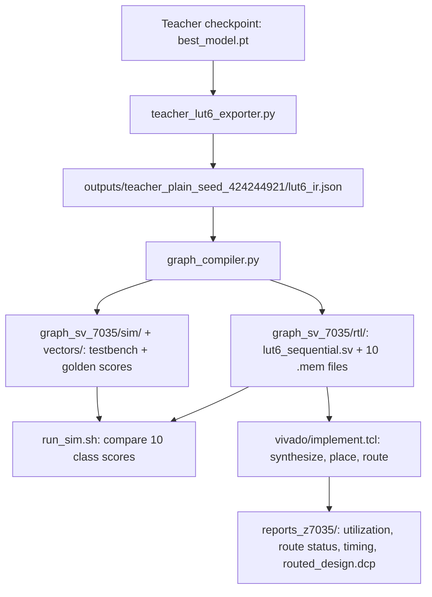
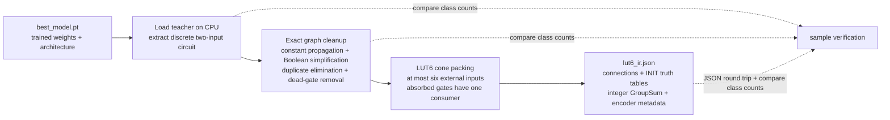
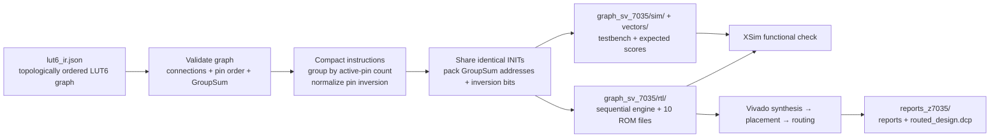

# Teacher LUT6 export and sequential FPGA bridge

This flow converts a trained two-input-gate CompactLogic teacher into a packed
LUT6 graph, then into a memory-based, sequential SystemVerilog design. The
FPGA interface accepts **pre-encoded Boolean input bits in CHW order**. CIFAR
and Heartbeat encoding and MNIST binarization are outside the RTL. The generated design evaluates one
graph node at a time, so it is not a fully parallel gate network.

## Data path and output folders



`graph_sv_7035` is the generated project folder. The checkpoint and JSON are
inputs to separate commands; simulation and Vivado write their results inside
that generated folder.

## 1. Export the checkpoint to JSON

Run from the repository root:

```bash
env PYTHONPATH=src:. python -m examples.phase_logic.New_post_training.teacher_lut6_exporter \
  --checkpoint "examples/phase_logic/results/bestof best/best-compact_shared_head2_v3_plain_w92400x92400_cuda_c16_explore800000_resample100_freeze200/aggressive_layer_aware_resampling_v1_conv25_d1_u50_i30_n5_c15_d2_u60_i25_n5_c10/hybrid_freeze_v3_probedriven_n4_sigma2_gap5000_probe1000_confirm3_drift1_flip0.001_taylor0.2_loss0.099/compact/build_model_cifar10_small_compact/pure_ce/seed_424244921/best_model.pt" \
  --output examples/phase_logic/New_post_training/outputs/teacher_plain_seed_424244921/lut6_ir.json \
  --verify-samples 4
```

The exporter loads the checkpoint on CPU, extracts its discrete Boolean
circuit, propagates constants, simplifies gates, removes duplicates and dead
gates, then packs eligible connected cones into LUT6 nodes. The JSON format is
`torchlogix_native_lut6_circuit_v1`: each node has six input descriptors and
a 64-bit truth table (`init_hex`), followed by exact integer GroupSum class
reductions. Pin 0 is the LUT address LSB. Skip edges, repeated GroupSum inputs,
and folded class offsets are retained. The JSON also records the encoder state
and source score scaling; it is **not** the student's layer-oriented
`hls4ml_lut6_ir_v1` format.

The same exporter accepts registered CompactLogic checkpoints for CIFAR-10,
CIFAR-100 (`build_model_cifar100_small_compact`), MNIST
(`build_model_mnist_small_compact`), and Heartbeat
(`build_model_heartbeat_small_compact`). The checkpoint loader selects the saved
model variant and its GroupSum class count. MNIST uses 1×28×28 binary input;
CIFAR uses its saved encoder and 32×32 input. Heartbeat uses 187 signal samples,
encoded as four Boolean channels of 11×17 bits. The LUT6 packing code is shared.
For example, export the MNIST and CIFAR-100 checkpoints independently:

```bash
env PYTHONPATH=src:. python -m examples.phase_logic.New_post_training.teacher_lut6_exporter \
  --checkpoint "examples/phase_logic/results/mnist/compact_shared_head2_v3_plain_w92400x92400_cuda_c16_explore800000_resample100_freeze200/hybrid_freeze_v3_probedriven_n4_sigma2_gap5000_probe1000_confirm3_drift1_flip0.001_taylor0.2_loss0.099/compact/build_model_mnist_small_compact/pure_ce/seed_4242/best_model.pt" \
  --output examples/phase_logic/New_post_training/outputs/mnist_seed_4242/lut6_ir.json

env PYTHONPATH=src:. python -m examples.phase_logic.New_post_training.teacher_lut6_exporter \
  --checkpoint "examples/phase_logic/results/cifar100/hybrid_q2_lbp2/crop_flip_augmentation/compact_shared_head2_v3_plain_w92400x92400_auto_c16_explore500000_resample100_freeze200/hybrid_freeze_v3_probedriven_n4_sigma2_gap5000_probe1000_confirm3_drift1_flip0.001_taylor0.2_loss0.099/compact/build_model_cifar100_small_compact/pure_ce/seed_4242449222/best_model.pt" \
  --output examples/phase_logic/New_post_training/outputs/cifar100_seed_4242449222/lut6_ir.json
```

Both paths verify exact integer class counts before writing JSON. CIFAR-100
produces 100 class reductions; MNIST produces 10. The encoded input interface
does not include the image preprocessing circuitry.



These are **exact Boolean graph transformations**, not retraining or
accuracy-based pruning. The exporter verifies sampled integer class scores
after the cleanup and packing passes, before handing the JSON to the bridge.

## 2. Compile JSON to SystemVerilog

```bash
env PYTHONPATH=examples/phase_logic/New_post_training/lut6_json_sv_bridge \
  python -m lut6_json_bridge.graph_compiler \
  --ir examples/phase_logic/New_post_training/outputs/teacher_plain_seed_424244921/lut6_ir.json \
  --out examples/phase_logic/New_post_training/outputs/teacher_plain_seed_424244921/graph_sv_7035 \
  --random-tests 1
```

The graph compiler emits `rtl/lut6_sequential.sv`, ten `.mem` files, a
self-checking testbench, `manifest.json`, and a Vivado Tcl script. Its ROMs
hold node arities, connection addresses, shared LUT truth tables, and GroupSum
references. One bit RAM stores the encoded input and intermediate node values.
The RTL reads ROM files by filename from its `rtl/` source directory; include
**all ten `.mem` files** when moving the project to another machine.



Before synthesis, the bridge compacts ROM storage and shares repeated truth
tables while preserving the graph's Boolean function and class scores. Vivado then
maps the generated memories and control logic to the chosen FPGA. The RTL
evaluates nodes sequentially using a shared value RAM, which saves hardware
at the cost of inference latency.

## 3. Verify functionality

The checkpoint exporter compares integer class scores from the loaded PyTorch
teacher against the extracted circuit, simplified circuit, packed LUT6 graph,
and JSON round trip on `--verify-samples` encoded examples. The graph compiler
then checks its ROM round trip and compares its program evaluator with the
native JSON evaluator on zero, one, patterned, and optional random input bits.
These scores become the testbench's golden vectors.

With Vivado tools on `PATH`, run from the generated `graph_sv_7035` directory:

```bash
source /home/j3k9j/AMD/2026.1/Vivado/settings64.sh
./run_sim.sh
```

The testbench streams each input bit, waits for `done`, and compares all ten
raw integer scores. The current teacher project passed four XSim vectors
(`ALL_TESTS_PASS cases=4`). These are sampled functional checks, not a formal
proof or a post-route simulation.

## 4. Synthesize and route

From the generated `graph_sv_7035` directory:

```bash
source /home/j3k9j/AMD/2026.1/Vivado/settings64.sh
vivado -mode batch -source vivado/implement.tcl \
  -tclargs xc7z035ffg676-2 z7035
```

The Tcl script creates `reports_z7035/` with synthesis, placement, and routed
utilization, route status, `routed_timing_summary.rpt`, and `routed_power.rpt`;
it also saves
`routed_design.dcp`. It stops if synthesis reports a missing ROM file.
For this teacher on Zynq-7035, Vivado routed all 1,966 routable nets with zero
routing errors and used 306.5 of 500 BRAM tiles (61.3%), 694 LUTs, and 472
registers. Resource use and timing depend on the target device and constraints;
read the generated timing summary for the actual routed timing result.

## 5. Analyze all generated Vivado reports

From the repository root, scan every generated `reports_*` directory and write
an `analysis.md` beside each report set plus a combined comparison:

```bash
python examples/phase_logic/New_post_training/report_analysis/generate.py \
  --outputs examples/phase_logic/New_post_training/outputs \
  --summary examples/phase_logic/New_post_training/outputs/report_analysis_summary.md
```

The summary groups runs by FPGA device and compares utilization, critical delay,
routing errors, and power. Missing implementation stages remain marked as
incomplete.

The generated Vivado implementation script automatically saves RAMB instance
inventories and hierarchical utilization reports during synthesis and routing.
The memory table groups BRAM by inferred instance name and reports unmatched
RAMB cells as `other`.
